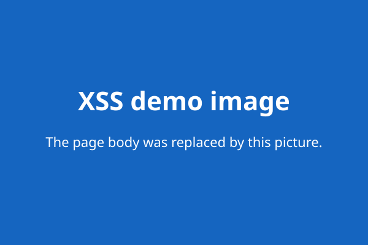

# Lab 03: XSS injection

This small local lab shows why user input must be escaped on output. It is a
guest-book. You submit a name, an e-mail, and a message. The page then lists
every entry. The same stored entries can be shown two ways.

## Requirements

- PHP 8 or newer
- The PHP PDO SQLite extension

## Run it

From the project root, run:

```sh
php -S 127.0.0.1:8000 -t lab03
```

Then open <http://127.0.0.1:8000>.

Use this lab only on your own computer. Stop the server with `Ctrl+C` when you
finish.

The entries are stored in `lab03/guest.sqlite`. That file is created on the
first request and kept between requests, so a stored attack keeps firing until
you clear the entries. Use the "Clear all entries" button, or delete the file,
to reset.

## The two modes

Switch modes with the buttons at the top.

- **Vulnerable mode** prints the stored name and message without escaping. It
  runs no input checks. Injected HTML and JavaScript run when the page loads.
  This is stored XSS: the attack is saved once and fires for every later
  visitor.
- **Safe mode** escapes every field on output with `escape()`. Injected code
  shows as plain text. It does not run.

Both modes store rows the same way, through a PDO prepared statement. The only
difference is how output is printed. Escaping on output is the one thing that
stops the XSS.

## Attacks to try

Switch to **vulnerable mode** first. Put anything in the name and e-mail. Paste
one payload into the message and add the entry. The attack fires as soon as the
list is drawn.

### Attack (a): redirect to another site

```html
<script>window.location='fake-site.php'</script>
```

The browser jumps to `fake-site.php`, a local mock phishing page. A real
attacker would send you to a page that copies your bank or e-mail login and
steals what you type.

To keep testing after this fires, open the guest-book, switch to safe mode so
the payload no longer runs, then clear the entries.

### Attack (b): replace the whole page with an image

```html
<script>document.body.innerHTML=''</script>
```

The script wipes everything inside `<body>` and puts one image in its place.
`demo.svg` is a local placeholder. It shows how an attacker can paint over the
real page with any picture.

## Check that safe mode blocks both

Switch to **safe mode** and paste the same payloads. They save as plain text
and show in the list as visible characters. Nothing runs.

## What the code demonstrates

The vulnerable output prints the raw column value:

```php
<td><?= $row['text_message'] ?></td>
```

The safe output escapes it first:

```php
<td><?= escape((string) $row['text_message']) ?></td>
```

`escape()` turns `<`, `>`, `"`, and `'` into HTML entities, so the browser
shows the text instead of running it:

```php
function escape(string $value): string
{
    return htmlspecialchars($value, ENT_QUOTES | ENT_SUBSTITUTE, 'UTF-8');
}
```

Output encoding is the defense against XSS. Checking the e-mail format or
rejecting empty fields does not stop XSS: a message field can hold `<script>`
as normal text, and no format check can tell that apart from real content. The
fix is to escape the value when you print it, so the browser shows it instead
of running it.
